 

 

 

 

 

  
  

  
  

 

  
  

  

  

  <picture>
    <source media="(prefers-color-scheme: dark)" srcset="https://raw.githubusercontent.com/MEHTABSINGH1/MEHTABSINGH1/output/github-snake-dark.svg"/>
    
  </picture>

**Building something with AI? Need an engineer who ships both the model *and* the app?**
 Let's talk → [LinkedIn](https://www.linkedin.com/in/mehtab-singh277) · [Email](mailto:msrandhawa760@gmail.com)

